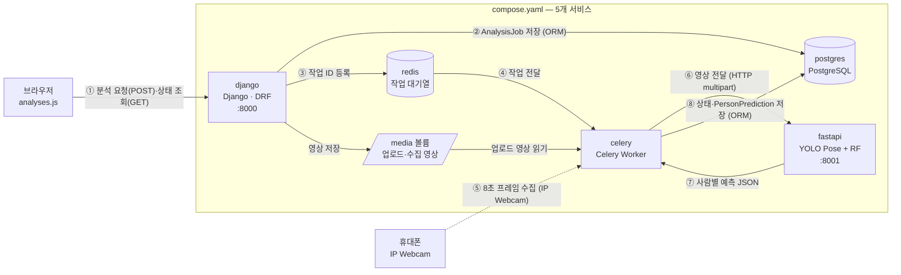
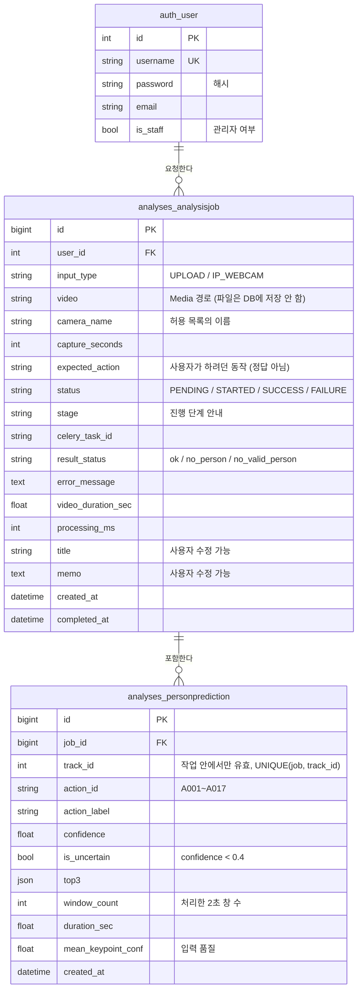
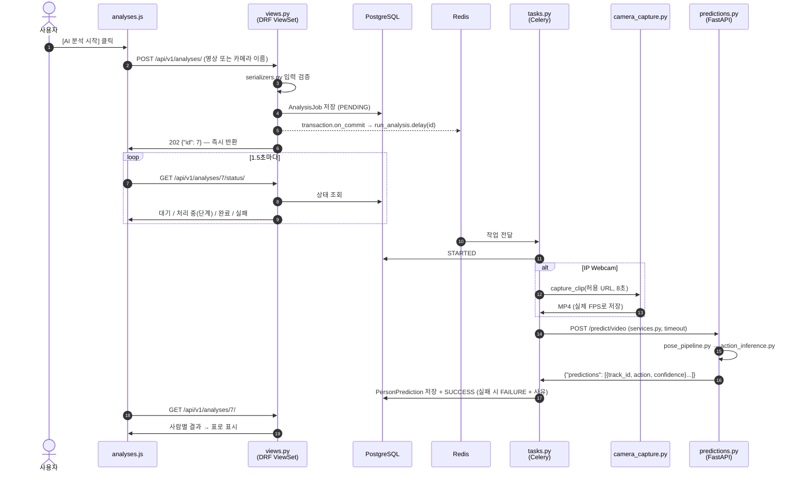

# Vision Action Platform — Motion Capture 17개 동작 인식 웹 서비스

## 1. 프로젝트 소개

`subject10_pose_action`에서 학습한 **Motion Capture 동작 인식 모델(Random Forest hybrid, 17개 동작)**을 **새로 학습하지 않고** 재사용합니다. 사용자가 브라우저에서 AI 분석을 요청하면 결과가 PostgreSQL에 저장되고, 관리자는 대시보드에서 통계를 확인합니다.

- **입력 2가지**: ① 영상 업로드(MP4 등) ② IP Webcam에서 정해진 시간(기본 8초) 수집
- **결과**: 영상 속 사람마다(Track ID별) 예측 동작, 신뢰도, 후보 2·3위, 판단 불확실 여부
- **Skeleton Overlay**: 사람별 관절 뼈대와 `ID·동작·신뢰도`를 그린 결과 영상(H.264 MP4)을 결과 화면에서 재생
- **IP Webcam 실시간 미리보기**: 카메라 화면에 관절을 그려 약 5fps로 보여 주고, 전신이 보이는지(초록/주황 테두리)·녹화 중 여부를 표시
- **관리**: Django Admin(작업·사람별 결과 검색/필터)과 관리자 전용 `/dashboard/`(Chart.js)

| 구분 | 내용 |
|---|---|
| 웹·API | Django 6.1 + DRF 3.18 (세션 로그인, 기본 `User`) |
| 비동기 | Celery 5.7 Worker + Redis 7 |
| AI 추론 | FastAPI + YOLO11n-Pose + ByteTrack + scikit-learn Random Forest |
| DB | PostgreSQL 17 (Django ORM만 접근) |
| 실행 | Docker Compose 5개 서비스 |

> 원래 과제 문서의 6개 동작(day06 `rf_action_baseline.joblib`) 대신, 같은 원본 프로젝트의 **최종 Motion Capture 모델(17개 동작)**을 사용했습니다. 그래서 Feature 규격이 `30×38=1,140`이 아니라 아래 [6장](#6-사용한-모델과-입력-형식)의 `175 + 503`입니다.

---

## 2. 실행 방법

### 2-1. Docker Compose (권장)

```bash
cp .env.example .env            # 값 수정: 비밀번호, SECRET_KEY, ALLOWED_CAMERAS
docker compose up --build -d    # 5개 서비스 실행 (django 시작 시 migrate 자동 실행)
docker compose ps               # 5개 모두 running / healthy 확인
docker compose exec django python manage.py createsuperuser   # 관리자 계정
```

모델 파일은 저장소의 `ai_service/models/`에 포함되어 있습니다(약 15MB). 다른 모델로 바꾸려면 같은 이름으로 덮어쓰고 `python scripts/check_model.py`로 확인하세요.

| 화면 | 주소 |
|---|---|
| 사용자 분석 화면 | http://localhost:8000/analyses/ |
| 회원가입 / 로그인 | http://localhost:8000/accounts/signup/ · /accounts/login/ |
| 관리자 대시보드 (staff만) | http://localhost:8000/dashboard/ |
| Django Admin | http://localhost:8000/admin/ |
| DRF API | http://localhost:8000/api/v1/analyses/ |
| FastAPI Swagger (개발용) | http://localhost:8001/docs |

재시작 후 데이터 유지 확인(T10):

```bash
docker compose restart
docker compose exec postgres psql -U vision -d vision_action -c "select id,status from analyses_analysisjob;"
```

> **GPU (선택)**: NVIDIA GPU가 있는 PC는 `.env`에 `COMPOSE_FILE=compose.yaml:compose.gpu.yaml`을 넣으면(주석 해제) 같은 `docker compose` 명령으로 fastapi가 CUDA 13.2 torch를 써서 GPU로 추론합니다. GPU가 없으면 그대로 두면 CPU로 동작합니다. 확인: `docker compose exec fastapi python -c "import torch;print(torch.cuda.is_available())"`

> **IP Webcam**: 카메라는 **celery 컨테이너**가 읽습니다. 휴대폰과 PC가 같은 Wi-Fi에 있어야 하고, `.env`의 `ALLOWED_CAMERAS=phone1=http://<휴대폰IP>:8080/video`에 등록된 카메라만 선택할 수 있습니다(사용자가 임의 URL 입력 불가). 변경 후 `docker compose up -d`로 재생성합니다.
> 휴대폰을 세로로 들었는데 미리보기에서 사람이 옆으로 누워 보이면 `.env`에 `CAMERA_ROTATION=phone1=90`(시계 방향 각도, 0/90/180/270)을 넣으세요. 수집·미리보기 단계에서 영상을 바로 세웁니다([7-3 문제 2](#7-3-겪은-문제와-해결) 참고).

### 2-2. Docker 없이 (개발용)

```bash
# AI 서버 (ai_service 폴더)
pip install -r requirements.txt
python scripts/check_model.py          # T01: 17개 Class, 175/503 Feature 확인
uvicorn main:app --port 8001

# Django + Celery (backend 폴더, PostgreSQL·Redis는 로컬에서 실행 중이어야 함)
pip install -r requirements.txt
python manage.py migrate
python manage.py createsuperuser
python manage.py runserver 8000
celery -A config worker -l info --pool=solo    # 다른 터미널
python manage.py test                          # 권한·상태·저장 테스트 14개
```

`USE_SQLITE=1`을 주면 PostgreSQL 없이 SQLite로 빠르게 테스트할 수 있습니다(제출용 실행은 PostgreSQL).

---

## 3. 전체 아키텍처



| 서비스 | 하는 일 | 하지 않는 일 |
|---|---|---|
| **django** | 회원·권한, 입력 검증(Serializer), 작업 생성·조회 API, 화면, Admin, 대시보드 집계 | AI 추론, 긴 작업을 요청 안에서 기다리기 |
| **celery** | 영상 확보(업로드 파일 / 카메라 수집) → FastAPI 호출 → ORM 저장, 실패 기록 | 화면 렌더링 |
| **fastapi** | 영상 → Pose·Tracking → Feature → Random Forest → JSON 반환 | DB 접근, 회원 관리 (SQLAlchemy 모델 없음) |
| **redis** | Celery 메시지 브로커 | 영구 데이터 저장 |
| **postgres** | 사용자·작업·사람별 예측 영구 저장 | — |

컨테이너끼리는 `localhost`가 아니라 서비스 이름(`http://fastapi:8001`, `redis://redis:6379`, `postgres`)으로 통신합니다. 영상 파일은 `media` 볼륨을 django와 celery가 공유하고, FastAPI에는 HTTP로 파일 자체를 보냅니다(FastAPI는 공유 볼륨이 필요 없음).

---

## 4. DB 설계 (ERD)

직접 작성한 모델: [`backend/analyses/models.py`](backend/analyses/models.py) — `AnalysisJob`, `PersonPrediction` 2개. 회원은 Django 기본 `auth_user`.



| 테이블 | 저장 내용 |
|---|---|
| `auth_user` | 회원 계정 (Django 기본) |
| `AnalysisJob` | 분석 요청 1건: 누가, 어떤 입력으로, 지금 어떤 상태인지, 실패 사유 |
| `PersonPrediction` | 영상 속 사람 1명의 예측. 두 사람이 나오면 작업 1건에 결과 2건 |

- 작업 삭제 시 `PersonPrediction`은 CASCADE로 함께 삭제되고 영상 파일도 지웁니다. 처리 중(`STARTED`) 작업은 삭제 불가.
- 사용자는 `title`, `memo`만 수정할 수 있습니다. 상태·예측값은 Serializer에서 read-only라 PATCH로 보내도 무시됩니다.

---

## 5. AI 분석 버튼 구현 흐름



**DB 저장 후 큐 등록**: `transaction.on_commit()`으로 커밋이 끝난 뒤에만 Celery 작업을 등록해서, Worker가 아직 저장되지 않은 Job을 찾는 경쟁 상태를 막습니다.

**영상 확보 방식**: 업로드는 Django가 `media` 볼륨에 저장한 파일을 Worker가 읽습니다. IP Webcam은 Worker가 카메라에 직접 연결해 정해진 초만큼 프레임을 모으고, 받은 프레임 수 ÷ 실제 시간으로 FPS를 계산해 MP4로 저장합니다(결과 화면에서 재생 가능).

---

## 6. 사용한 모델과 입력 형식

원본: `subject10_pose_action/scripts/48_test_motion_capture_actions.py`로 학습한 산출물 (S01~S05, 5명 × 17동작 × 3방향 + 좌우반전 증강)

> **현재 서비스 모델은 증강 재학습판입니다** (`subject10_pose_action/scripts/51_train_augmented_motion_model.py`, [7-5](#7-5-기존-영상-증강으로-재학습)). 같은 255개 영상의 관절 좌표를 FPS·정지 구간·속도로 증강해 Feature 규격(175·503)과 17개 동작은 그대로 두고 다시 학습했습니다. 처음 학습한 모델은 `subject10_pose_action/artifacts/motion_capture/`에 그대로 있습니다(되돌리려면 세 파일을 `ai_service/models/`에 복사하고 `project.json`의 `static_trim.enabled`를 `true`로).

| 파일 (`ai_service/models/`) | 역할 |
|---|---|
| `action_model.joblib` | robust2 **창(2초) 모델**. 입력 175 = Frame Feature 35개 × 통계 5개(mean·std·min·max·속도) |
| `clip_model.joblib` | 트랙 **전체 요약 모델**. 입력 503 = 10구간 평균 흐름 + 통계 + 세로 속도 |
| `model_info.json` | `window_sec=2.0`, `stride_sec=0.25`, 학습 `fps=59.88`, `classes`(17개) |
| `feature_columns.json` | 두 모델의 Feature 이름과 **순서** (`scripts/check_model.py`가 생성·검증) |
| `action_classes.csv` | A001~A017 ↔ 영문 label ↔ 한글 이름 |
| `yolo11n-pose.pt` | 학습 때 사용한 YOLO Pose 가중치 (COCO 17 Keypoint) |

복사한 원본 코드: `ai_service/src/motion_capture_features.py`(Feature 계산, 학습과 **같은 함수**), `src/pose_utils.py`(COCO 관절 이름), `bytetrack_stable.yaml`(8일차 안정화 Tracker).

**지원 동작 (17개)**: 키오스크 두드리기, 한손 물건 던지기, 앞차기, 잡고 흔들기, 밀치기, 휘두르기, 바닥에 앉기, 위에 앉기, 앞으로 눕기, 뒤로 눕기, 몸통 박치기, 쪼그려 물건 빼내기, 샷건, 구토, 옆으로 쓰러지기, 뒤로 넘어지기, 앞으로 넘어지기

**추론 순서** (`ai_service/services/`):

1. `pose_pipeline.py` — YOLO Pose + ByteTrack으로 Track ID별 관절(17×2)을 모음. 화면 높이 20% 미만의 작은 사람, 어깨·엉덩이가 안 보이는 프레임은 제외
2. 트랙을 **학습 FPS(59.88)로 보간** — 웹캠(10~15fps)이든 업로드(30·60fps)든 속도 Feature가 학습 때와 같은 의미가 되도록. 0.25초 넘게 끊긴 구간은 NaN으로 두어 계산에서 제외
3. `action_inference.py` — 2초 창을 0.25초 간격으로 잘라 창 모델 확률 평균 + Clip 모델 확률 → `/2` → 최대값이 예측, 그 값이 신뢰도
4. 1초 이상 보인 사람만 판단. 신뢰도 0.4 미만은 `is_uncertain=true` → 화면에 **판단 불확실**

**입력**: mp4·avi·mov·mkv·webm, 최대 100MB, 최소 1초. 동작 1회가 담긴 2~10초 영상 권장. IP Webcam 수집 시간 5~10초(기본 8초).

**FastAPI API 계약**

| 엔드포인트 | 입력 | 반환 |
|---|---|---|
| `GET /health` | 없음 | `model_ready`, 클래스 목록, Feature 수 |
| `POST /predict/video` (`/api/v1/predict/` 동일) | multipart `file`, 선택 `?overlay=true` | 아래 JSON (+ `overlay: {url, frames, fps, width, height, render_ms}`) |
| `GET /overlay/{id}` | 없음 | Overlay MP4 (한 번 내려주면 삭제, 안 가져간 파일은 1시간 뒤 정리) |
| `POST /pose/frame` | multipart `file` (JPEG 1장) | 관절을 그린 JPEG + 헤더 `X-Pose-Status`(`ok`·`no_person`·`core_missing`·`sideways`·`legs_missing`·`too_far`), `X-Pose-Keypoint-Conf` |

**실시간 미리보기 흐름**: 브라우저(`analyses.js`)가 0.2초마다 `GET /api/v1/analyses/cameras/{이름}/preview/` → Django(`camera_preview.py`)가 허용된 카메라의 `/shot.jpg`를 받아 회전·축소 → FastAPI `/pose/frame`이 관절을 그리고 촬영 자세를 판정(영상 분석과 별도 YOLO 객체라 분석 중에도 멈추지 않음, 1장 약 30ms) → 브라우저가 테두리 색과 안내 문구로 표시. 카메라 주소는 브라우저에 노출되지 않습니다.

**녹화 실시간 초 카운터**: Celery가 카메라에서 **첫 프레임을 받은 순간**을 `AnalysisJob.capture_started_at`에 기록하고(연결에 걸린 시간은 수집 시간에서 제외), 상태 API(`/status/`)가 `capture_elapsed`(녹화 시작 후 지난 초, 서버 기준)를 돌려줍니다. 브라우저는 녹화 중 0.5초마다 상태를 확인하면서 그 값을 기준으로 0.1초 단위로 이어서 세어 결과 카드에 큰 숫자(`3.2 / 8초`, 남은 시간)와 진행 막대를, 미리보기에 `● 녹화 중 3.2초 / 8초`를 보여 줍니다. 단계는 `카메라 연결 중` → `영상 수집 중` → `AI 분석 중` → `완료` 순서로 표시됩니다.

Overlay(`ai_service/services/overlay.py`): 추론이 끝난 뒤 같은 OpenCV 디코더로 영상을 다시 읽어 Track ID마다 다른 색으로 뼈대와 이름표를 그립니다. 긴 변 720px·30fps 이하로 줄이고 PyAV(libx264)로 H.264 인코딩합니다(OpenCV pip 빌드에는 H.264 인코더가 없음, VP8 WebM보다 9배 빠르고 파일은 1/20). Overlay 생성·전송이 실패해도 분석 결과는 SUCCESS로 저장되고, `.env`의 `ANALYSIS_OVERLAY=False`로 끌 수 있습니다.

```json
{
  "status": "ok",
  "message": "2명의 동작을 예측했습니다.",
  "video": {"fps": 30.0, "frame_count": 386, "duration_sec": 12.87, "width": 1080, "height": 960, "frames_read": 386},
  "predictions": [
    {"track_id": 1, "action_id": "A007", "action_label": "sit_floor", "action_name": "바닥에 앉기",
     "confidence": 0.4779, "is_uncertain": false,
     "top3": [{"action_id": "A007", "action_label": "sit_floor", "probability": 0.4779},
              {"action_id": "A015", "action_label": "fall_sideways", "probability": 0.1592},
              {"action_id": "A008", "action_label": "sit_on_object", "probability": 0.0827}],
     "window_count": 44, "frame_count": 386, "duration_sec": 12.83, "mean_keypoint_conf": 0.937},
    {"track_id": 2, "action_id": "A013", "action_label": "shotgun", "action_name": "샷건",
     "confidence": 0.2016, "is_uncertain": true, "...": "..."}
  ],
  "skipped_track_ids": [],
  "processing_ms": 4427
}
```

| 상황 | FastAPI 응답 | Worker 처리 → 화면 |
|---|---|---|
| 정상 | 200, `status=ok` | SUCCESS + 사람별 결과 |
| 사람 없음 | 200, `status=no_person`, `predictions=[]` | SUCCESS + "영상에서 사람을 찾지 못했습니다." |
| 사람은 있지만 너무 짧게/가려져 보임 | 200, `status=no_valid_person` | SUCCESS + 안내 메시지 |
| 손상·지원하지 않는 파일 | 400 `{"detail": 사유}` | FAILURE + 사유 |
| 1초 미만 영상 | 422 | FAILURE + 사유 |
| FastAPI 꺼짐·시간 초과 | 연결 오류 | FAILURE + "AI 서버에 연결할 수 없습니다." |

---

## 7. 실행 결과와 검증

### 7-1. 기능 테스트 (T01~T10)

로컬(WSL, RTX 3060)에서 FastAPI·Django·실제 Celery Worker를 띄워 확인한 결과입니다. 캡처는 `docs/images/`에 추가하세요.

| 테스트 | 입력 | 결과 |
|---|---|---|
| T01 모델 불러오기 | `python scripts/check_model.py` | 17 Class, 창 175 / Clip 503 Feature, classes 순서 일치 → **PASS** |
| T02 영상 업로드 | S05 앞차기(3.6초, 60fps) | 작업 #1 SUCCESS — track1 `A003 front_kick` 0.63, AI 4.2초 |
| T03 IP Webcam | MJPEG 스트림 8초 수집(13.6fps), 밀치기 | 작업 #3 SUCCESS — track1 `A005 push` 0.35 (**판단 불확실** 표시) |
| T04 사람별 결과 | 두 사람을 좌우로 붙인 영상 | 작업 #2에 결과 2건 — track1 `sit_floor`, track2 `shotgun` |
| T05 비동기 | 업로드 요청 | 0.28초 만에 `{"id":1,"status":"PENDING"}` 반환, 분석은 Worker가 진행 |
| T06 영구 저장 | 완료 후 목록 재조회 | 같은 작업·예측이 DB에 남음 |
| T07 CRUD 권한 | alice 작업을 bob이 조회·수정·삭제 | 모두 404, bob 목록 0건 (`analyses/tests.py`) |
| T08 관리자 | staff / 일반 회원으로 `/dashboard/` | staff 200, 일반 회원 로그인 페이지로 이동. 차트 숫자 = DB 집계(SUCCESS 4, FAILURE 2) |
| T09 예외 처리 | 꺼진 카메라 / 깨진 파일 / 빈 화면 영상 | #4 FAILURE "카메라에 연결할 수 없습니다", #5 FAILURE "영상 파일을 열 수 없습니다", #6 SUCCESS "사람을 찾지 못했습니다" |
| T10 Docker 재시작 | 업로드 분석 완료 후 `docker compose restart` | 5개 서비스 모두 재연결(fastapi·postgres·redis healthy), 작업 #1 SUCCESS와 `front_kick` 0.766 예측이 PostgreSQL에 그대로 남음 → **PASS** |

**Docker Compose 환경 재확인**: 5개 컨테이너에서 S03 앞차기(S03_A003_T01) 업로드 → POST 0.34초 만에 작업 ID 반환(T05) → Celery·FastAPI 처리 후 SUCCESS, `A003 front_kick` 0.77, AI 9.9초(CPU) (T02) → 재시작 후 DB 유지(T10). 컨테이너 안에서 `docker compose exec django python manage.py test`도 14개 통과.

자동 테스트: `python manage.py test` → 26개 통과 (회원가입·중복·로그인·비로그인 차단, 작업 생성·권한·PATCH 제한·삭제·AI 실패·카메라 실패·대시보드 권한, AI 서버 재시도 3개, Overlay 저장·실패 2개, 카메라 미리보기 5개, 녹화 초 카운터 2개).

### 7-1-1. 성능 고도화 (속도·안정성)

| 항목 | 변경 전 | 변경 후 | 근거 |
|---|---|---|---|
| AI 추론 장치 | CPU (torch cpu) | **GPU RTX 3060** (`compose.gpu.yaml`, torch cu132) | 3.7초 영상 추론 9.0초 → **4.3초** (결과 동일 `front_kick` 0.764) |
| 웹 서버 | `runserver` (개발용, 1 프로세스) | **gunicorn 3 workers** + WhiteNoise 정적 파일 | 동시 요청 처리, 업로드 중에도 상태 조회 응답 |
| AI 서버 일시 장애 | 즉시 FAILURE | 연결 실패·503(모델 로딩 중)은 **최대 3번 재시도**(3·6·9초 간격) | `analyses/services.py`, 테스트 3개 |
| 오래 걸리는 작업 | 제한 없음 (Worker가 묶일 수 있음) | Celery `soft_time_limit`(기본 420초) 초과 시 FAILURE + 안내 메시지 | `analyses/tasks.py` |
| 결과 화면 | 원본 영상만 재생 | **Skeleton Overlay** 영상 재생 (3.7초 60fps 영상 기준 +1.8초, 278KB) | `services/overlay.py`, 테스트 2개 |
| IP Webcam 수집 메모리 | 1080p 원본 프레임을 모두 메모리에 (8초 약 3GB) | 받는 즉시 회전·긴 변 1280px 축소·JPEG 압축 (약 50MB) | `camera_capture.py` (Feature는 몸통 길이로 정규화되어 해상도 무관) |
| IP Webcam 촬영 | 무엇이 찍히는지 모른 채 녹화 | **실시간 미리보기** + 전신 인식 판정 + 결과의 "입력 품질 낮음" 경고 | `camera_preview.py`, `live_pose.py`, 테스트 5개 |
| 8초 수집의 정지 구간 | 서 있던 구간까지 평균 → 신뢰도 하락 | 정지 구간을 줄인 예측과 전체 예측의 **기하평균** | `services/temporal.py`, `project.json`의 `static_trim` ([7-3 문제 3](#7-3-겪은-문제와-해결)) |

**측정 방법·판단**: 컨테이너 안에서 단계별 시간을 쟀더니 CPU에서는 YOLO Pose가 95%(프레임당 43ms)였고, GPU로 바꾼 뒤에는 **HDR(10bit HEVC) 휴대폰 영상의 디코딩·색 변환**이 대부분이었습니다.

- PyAV로 디코딩하면 3.5배 빠르지만 HDR 톤매핑이 달라 학습 때(OpenCV)와 다른 색의 이미지가 들어가므로 **채택하지 않았습니다**.
- 60fps 영상을 30fps로 건너뛰며 처리하는 옵션(`project.json`의 `max_process_fps`)을 만들고 정답이 있는 34개 영상으로 비교했습니다.

| `max_process_fps` | 정확도 | 평균 신뢰도 | 34개 처리 시간 |
|---|---|---|---|
| 0 (모든 프레임, **기본값**) | 34/34 | 0.722 | 233초 |
| 30 | 34/34 | 0.625 | 129초 |
| 20 | 34/34 | 0.559 | 96초 |

정확도는 같지만 신뢰도가 떨어지므로(Feature가 학습 분포에서 멀어짐) 기본값은 0(끔)으로 두었습니다. GPU가 없는 PC에서 속도가 중요하면 30으로 바꿀 수 있습니다.

### 7-2. 캡처 (제출 전 추가)

- [ ] 정상 분석 1건 — `docs/images/success.png`
- [ ] 오류·실패 1건 — `docs/images/failure.png`
- [ ] Django Admin 목록 — `docs/images/admin.png`
- [ ] 관리자 대시보드 — `docs/images/dashboard.png`
- [ ] `docker compose ps` 5개 서비스 — `docs/images/compose.png`

캡처에 카메라 IP·비밀번호가 보이지 않게 주의하세요.

### 7-3. 겪은 문제와 해결

**문제: 낮은 FPS(웹캠) 영상에서 동작이 엉뚱하게 나옴**

1. **현상** — 60fps 밀치기 영상(S03_A005_T01)을 휴대폰 카메라처럼 15fps로 줄여 보내면 **`A013 shotgun` 0.52**로 잘못 예측됐습니다(정답 push는 0.19).
2. **확인한 곳** — `motion_capture_features.py`의 속도 Feature(`speed()`)는 "프레임당 이동량"입니다. 학습 영상은 약 60fps라서, 15fps 영상은 같은 움직임이 프레임당 4배 빠른 것으로 계산됐습니다. 2초 창도 프레임 수(120장)로 자르기 때문에 15fps에서는 8초 분량이 한 창에 들어갔습니다. → 빠르게 팔을 뻗는 샷건으로 오인.
3. **바꾼 것** — `pose_pipeline.resample_track()`에서 트랙을 **학습 FPS(59.88)로 시간 보간**한 뒤 Feature를 계산합니다. 카메라 수집(`camera_capture.py`)은 실제로 받은 프레임 수 ÷ 실제 시간으로 FPS를 기록해 영상 시간축이 실제와 맞게 했습니다.
4. **확인** — 같은 15fps 영상이 **`A005 push` 0.63**으로 원본과 같은 동작이 나왔습니다.

**문제 2: IP Webcam으로 분석하면 신뢰도가 매우 낮고 '눕기'로 나옴**

1. **현상** — 업로드 영상은 신뢰도 0.74~0.91인데, 휴대폰 IP Webcam으로 8초 수집한 작업 #8은 `A010 lie_backward` **0.37**, 관절 신뢰도도 업로드(0.97)보다 훨씬 낮은 **0.36**이었습니다.
2. **확인한 곳** — 저장된 수집 영상(`camera_job_8.mp4`)을 프레임별로 YOLO에 넣어 봤습니다. ① 휴대폰을 세로로 들었지만 앱이 가로로 송출해 **사람이 90° 옆으로 누운 화면**이었고, ② 너무 가까워 얼굴·상체만 보여 **17개 관절 중 12개(골반·무릎·발목)가 검출되지 않았습니다**. Feature는 y축을 '위아래'로 가정하므로(`hip_y`, 세로 속도 등) 옆으로 누운 사람은 '눕기'와 같은 값이 됩니다. 업로드 영상 3개를 일부러 90° 돌려 넣어 재현했습니다.

   | 영상 (정답) | 원본 | 90° 회전 |
   |---|---|---|
   | S03 밀치기 (A005) | `A005 push` 0.76 | `A010 lie_backward` 0.22 |
   | S01 앞차기 (A003) | `A003 front_kick` 0.74 | `A010 lie_backward` 0.28 |
   | S05 키오스크 (A001) | `A001 kiosk_tap` 0.91 | `A016 fall_backward` 0.25 |

3. **바꾼 것** — 모델이 아니라 **입력**을 고쳤습니다. `.env`의 `CAMERA_ROTATION`으로 카메라별 회전을 지정해 수집·미리보기 단계에서 바로 세우고, **실시간 미리보기**로 전신이 보이는지 촬영 전에 확인하게 했습니다(어깨·골반·발목 검출과 몸통 방향으로 `ok`/`core_missing`/`sideways`/`legs_missing` 판정). 결과 화면은 관절 신뢰도 0.6 미만이면 "입력 품질 낮음"과 해결 방법을 함께 보여 줍니다.
4. **확인** — 옆으로 누운 사진에 회전 90°를 적용하면 미리보기 판정이 `sideways`(관절 0.88)에서 `ok`(관절 0.97)로 바뀌었습니다. 위 표처럼 똑바로 선 영상은 정답이 0.74~0.91로 나옵니다.

**문제 3: 화면이 정상이어도 웹캠 결과의 신뢰도가 업로드보다 낮음**

1. **현상** — 웹캠 수집 영상은 업로드 클립과 조건이 다릅니다. 정답이 있는 34개 영상의 관절 트랙에 웹캠 조건을 입혀(`ai_service/scripts/eval_webcam_sim.py`, 3개 난수 × 34 = 102건) 재현하니 평균 신뢰도가 **0.72 → 0.35**, "판단 불확실"이 **69%**가 됐습니다.
2. **확인한 곳** — 조건을 하나씩 떼어 측정했습니다.

   | 재현 조건 | 정확도 | 평균 신뢰도 |
   |---|---|---|
   | 원본 클립 | 100% | 0.722 |
   | 동작 앞뒤에 정지 구간 (8초 수집) | 94.1% | 0.434 |
   | 15fps ±20% 간격 | 97.1% | 0.438 |
   | 관절 흔들림만 | 97.1% | 0.568 |
   | 위 세 가지 모두 | 96.1% | 0.346 |

   학습 클립은 동작 전후 정지 구간이 짧습니다(앞 중앙값 0.13초, 뒤 0.31초). 8초 수집은 앞뒤로 2초 넘게 서 있는 구간이 생기고, 창 확률을 평균할 때 이 구간이 섞여 확률이 퍼집니다. 낮은 FPS는 60fps에서만 보이는 빠른 움직임 정보가 사라져서 생기므로, 재학습 없이는 되살릴 수 없고 **높은 FPS로 수집하는 것**이 해법입니다(이 프로젝트의 휴대폰은 약 60fps, 수집 처리는 프레임당 2.7ms라 FPS를 떨어뜨리지 않음).
3. **시도한 방법** (102건 웹캠 조건 기준, 재학습 없음)

   | 방법 | 원본 정확도 | 웹캠 정확도 | 웹캠 신뢰도 | 판단 |
   |---|---|---|---|---|
   | 기존 (전체 평균) | 100% | 96.1% | 0.346 | |
   | 동작 구간만 잘라 판단 | 94.1% | 91.2% | 0.489 | 동작 후 자세(누운 상태 등)까지 잘려 오답 증가 → 제외 |
   | 관절 시간 평활 | 97.1% | 86.3% | 0.305 | 모델이 원래 관절 떨림까지 학습해 오히려 악화 → 제외 |
   | 확신 높은 창만 평균 | 100% | 89.2% | 0.409 | 정확도 하락 → 제외 |
   | **정지 구간 축소(앞 0.6초·뒤 0.8초) + 전체 예측과 기하평균** | **100%** | **97.1%** | **0.399** | **채택** |

4. **바꾼 것** — `services/temporal.py`가 움직임 곡선(관절 이동량/몸통 길이)에서 동작 구간을 찾아 앞뒤 정지 구간을 학습 클립 수준으로 줄인 트랙을 만들고, `predict_track()`이 전체 트랙 확률과의 **기하평균**을 씁니다. 두 예측이 모두 동의하는 동작이 강해지고, 동작 후 자세 정보도 남습니다. 정지 구간이 없는 업로드 클립은 결과가 그대로입니다(`trimmed_static_sec: 0`). `project.json`의 `static_trim.enabled`로 끌 수 있습니다.
5. **확인** — 8초 정지 구간 조건: 정확도 94.1% → **100%**, 신뢰도 0.434 → **0.507**, 불확실 41% → **26%**. 웹캠 전체 조건: 96.1% → **97.1%**, 0.346 → **0.399**, 불확실 69% → **46%**. 원본 클립은 정확도 100% 유지.
   - 한계: 이 34개 영상은 학습에 쓴 사람(S01~S05)이라 절대 정확도는 실제보다 높게 나옵니다. 방법 사이의 **차이**를 비교하는 용도입니다. 실제 휴대폰 촬영으로 다시 확인이 필요합니다.
   - 이후 [7-5](#7-5-기존-영상-증강으로-재학습)에서 처음 보는 사람 기준으로 다시 재 보니, 이 방법은 원본 클립 정확도를 0.890 → 0.867로 낮추는 손해가 있었습니다. 증강 재학습 모델에서는 꺼 두었습니다.

### 7-5. 기존 영상 증강으로 재학습

> 과제 기본 원칙은 "모델을 새로 학습하지 않는다"입니다. 아래는 **새 촬영 없이 기존 255개 영상의 관절 좌표만 증강해** 다시 학습한 선택 확장이며, 처음 모델은 그대로 보관합니다.

**방법** — `subject10_pose_action/scripts/51_train_augmented_motion_model.py`
- 46번이 뽑아 둔 관절 CSV를 변형해 학습 데이터를 늘립니다(영상·YOLO를 다시 돌리지 않음). Feature는 **웹 서비스와 같은 코드**(`resample_track` 59.88fps 보간)로 계산해 학습과 추론의 입력을 일치시켰습니다. 이 경로로 학습한 쪽이 48번 방식(CSV 그대로)보다 모든 조건에서 정확했습니다(원본 0.890 vs 0.871, 웹캠15fps 0.800 vs 0.739).
- 평가는 **사람 교차 검증**(5명 중 1명을 빼고 학습 → 뺀 사람의 실제 영상 51개로 시험, 5회)입니다. 시험 영상은 증강하지 않고, 원본 그대로·웹캠 재현 2가지(8초 수집 앞뒤 정지 구간 + 15fps±20% 또는 60fps + 관절 흔들림)로 시험했습니다.

**증강 하나씩 효과** (사람 교차, 정확도)

| 증강 | 내용 | 원본 | 웹캠 15fps | 웹캠 60fps | 판단 |
|---|---|---|---|---|---|
| 없음 | – | 0.890 | 0.800 | 0.831 | 기준 |
| **fps** | 10~30fps ±20% 간격으로 다시 뽑기 | 0.890 | **0.876** | 0.851 | 채택 |
| **pad** | 앞뒤 0.3~3초 정지(미세 흔들림) | 0.867 | 0.876 | **0.884** | 채택 |
| **speed** | 시간축 0.8~1.25배 | **0.906** | 0.843 | 0.857 | 채택 |
| mirror | 좌우 반전 + 왼/오른 관절 교환 | 0.894 | 0.824 | 0.835 | 효과 작음 |
| camera | ±8° 기울기·0.85~1.15배·느린 흔들림 | 0.886 | 0.818 | 0.833 | 효과 작음 |
| noise | 관절 잡음·프레임 누락·손발 미검출 | 0.878 | 0.839 | 0.845 | 효과 작음 |

**섞어서** (원본 1개당 증강본 수·각 증강 적용 확률)

| 조합 | 원본 | 웹캠 15fps | 웹캠 60fps | 웹캠 15fps 평균 신뢰도 / 불확실 |
|---|---|---|---|---|
| 없음 | 0.890 | 0.800 | 0.831 | 0.33 / 75% |
| fps+pad+speed ×4 p0.5 | 0.882 | 0.876 | 0.878 | 0.41 / 49% |
| **fps+pad+speed ×6 p0.7 (채택)** | **0.882** | **0.878** | **0.900** | **0.42 / 45%** |
| fps+pad+speed ×10 p0.7 | 0.886 | 0.865 | 0.880 | 0.43 / 45% |
| fps+speed ×6 p0.7 (pad 없음) | 0.906 | 0.847 | 0.853 | 0.37 / 67% |
| + noise | 0.855 | 0.871 | 0.861 | |
| + camera + noise | 0.863 | 0.871 | 0.875 | |
| + mirror + camera + noise | 0.863 | 0.865 | 0.869 | |

(위 숫자는 정지 구간 축소를 끈 값. 하나씩 실험 표의 웹캠 열은 켜고 끈 것 중 나은 값)

**결과** — 웹캠 조건 정확도 **+7.8%p(15fps)·+6.9%p(60fps)**, 평균 신뢰도 0.33 → 0.42, "판단 불확실" 75% → 45%. 원본 클립은 0.890 → 0.882(255개 중 2개 차이). 잡음·카메라·반전 증강은 섞을수록 원본 정확도를 떨어뜨려 넣지 않았습니다. 정지 구간 증강 덕분에 서비스의 정지 구간 축소(7-3 문제 3)는 끄는 쪽이 더 정확해 `static_trim.enabled=false`로 바꿨습니다.

**배포** — 5명 전체로 다시 학습(트랙 1,785개)해 `ai_service/models/`에 저장했습니다. 창 모델이 커져서(47MB) xz 압축으로 24MB로 줄였습니다(예측 동일, 로드 1.3초). `scripts/check_model.py` T01 PASS(17 Class, 175/503 Feature).

**실제 휴대폰 영상** — 손에 들고 걸어오며 찍은 웹캠 #10(앞차기)은 `front_kick` 0.333 → **0.384**로 정답을 유지하며 올랐지만, 학습 조건(고정 카메라·제자리)과 달라 오름폭이 작습니다. 고정 카메라·제자리에서 찍으면 위 교차 검증 수치에 가까울 것으로 봅니다(미확인).

### 7-4. 정확도 주의

- 학습 데이터는 5명 × 17동작뿐입니다. 사람 교차 검증(처음 보는 사람) 영상 단위 정확도는 원본 클립 **0.88~0.91**, 웹캠 조건 재현 **0.88~0.90**(증강 재학습 모델, 7-5)이지만, 새 사람·새 장소·다른 카메라 각도에서는 틀릴 수 있습니다.
- 학습하지 않은 동작에도 17개 중 하나를 출력합니다. 예측은 **참고용이며 위험행동 판정이 아닙니다**. 신뢰도와 관절 신뢰도(입력 품질)를 함께 보세요.
- 업로드와 IP Webcam 결과의 신뢰도 차이는 촬영 거리·FPS·사람이 달라서 생길 수 있으므로 모델 성능 우열로 단정하지 않습니다.
- 틀렸을 때는 **입력 품질 → Pose → Feature → Window → 모델 → 저장** 순서로 원인을 찾습니다.

---

## 부록 A. 폴더 구조

```text
vision_action_platform/
├── backend/                     # Django·DRF + Celery Worker (같은 이미지)
│   ├── config/                  # settings.py · urls.py · celery.py
│   ├── accounts/                # 회원가입(views.py, forms.py)·로그인/로그아웃(기본 뷰)
│   ├── analyses/
│   │   ├── models.py            # AnalysisJob, PersonPrediction
│   │   ├── serializers.py       # 입력 검증·응답·수정 가능 필드 제한
│   │   ├── views.py             # DRF ViewSet (CRUD + status + cameras)
│   │   ├── tasks.py             # Celery: 영상 확보 → FastAPI → ORM 저장
│   │   ├── services.py          # FastAPI HTTP 호출·타임아웃·오류
│   │   ├── camera_capture.py    # 허용된 IP Webcam에서 N초 수집 (회전·축소)
│   │   ├── camera_preview.py    # 실시간 미리보기 (shot.jpg → 회전 → FastAPI 관절)
│   │   ├── page_views.py        # /analyses/ 화면, /dashboard/ ORM 집계
│   │   ├── admin.py             # Admin 목록·검색·필터
│   │   └── tests.py
│   ├── templates/               # base, login, signup, analyses/index, dashboard
│   └── static/                  # css/app.css, js/analyses.js, js/dashboard.js
├── ai_service/                  # FastAPI
│   ├── main.py                  # 앱 생성, /health, 시작 시 모델 1회 로드
│   ├── routers/predictions.py   # POST /predict/video
│   ├── services/                # model_loader · pose_pipeline · action_inference · temporal · overlay · live_pose
│   ├── src/                     # 원본 프로젝트에서 복사한 Feature·Pose 코드
│   ├── models/                  # joblib·JSON·CSV·YOLO 가중치
│   ├── scripts/check_model.py   # T01
│   ├── scripts/eval_webcam_sim.py # 웹캠 조건 재현 평가 (7-3 문제 3)
│   └── project.json             # Pose·Tracking·판단 기준 설정
├── compose.yaml                 # django · celery · fastapi · redis · postgres
├── compose.gpu.yaml             # (선택) fastapi GPU 추론 설정
├── .env.example
└── README.md
```

## 부록 B. 발표 질문에 대한 답

- **왜 joblib 하나로는 MP4를 분류할 수 없나?** Random Forest는 숫자 벡터(175·503차원)만 받습니다. 영상 → 관절 검출(YOLO) → 사람 추적 → 정규화된 각도·거리·속도 Feature → 창 통계로 바꾸는 과정이 학습 때와 똑같아야 합니다.
- **Feature 순서를 바꾸면?** 모델은 "몇 번째 칸"으로만 값을 구분하므로 순서가 바뀌면 에러 없이 엉뚱한 예측을 냅니다. 그래서 `feature_columns.json`과 `n_features_in_`를 서버 시작 시 검사합니다.
- **`model.classes_`의 역할?** `predict_proba()` 결과의 각 칸이 어떤 동작인지 알려줍니다. 두 모델의 `classes_` 순서가 같아야 확률을 더할 수 있어서 로드 시 비교합니다.
- **FastAPI는 JSON만, 저장은 Django가 하는 이유?** DB 스키마·권한·트랜잭션을 한 곳(Django ORM)에서 관리하고, AI 서버는 교체·확장이 쉬운 독립 추론기로 둡니다.
- **요청에서 끝까지 기다리지 않는 이유?** 분석은 수 초~수십 초 걸립니다. 작업 ID를 즉시 돌려주면 브라우저가 멈추지 않고 진행 상태를 보여줄 수 있으며, 웹 서버 Worker도 묶이지 않습니다.
- **대시보드는 누가 집계?** Django ORM(`page_views.dashboard`)이 PostgreSQL을 집계해 템플릿에 넘기고, Chart.js는 그리기만 합니다. FastAPI는 DB에 접근하지 않습니다.
